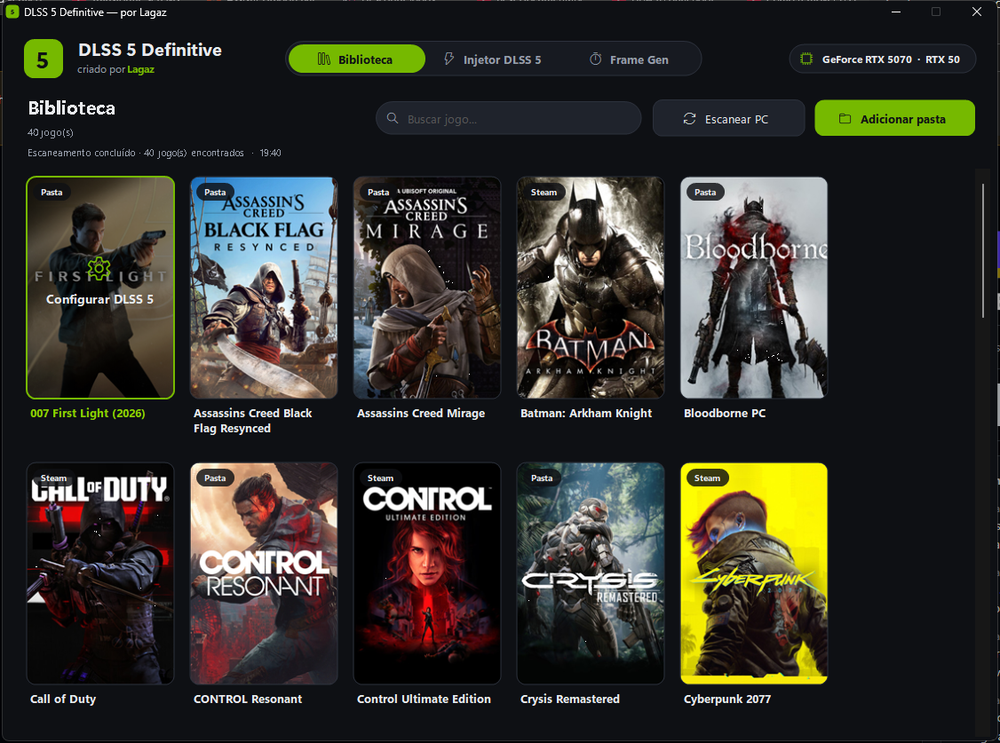
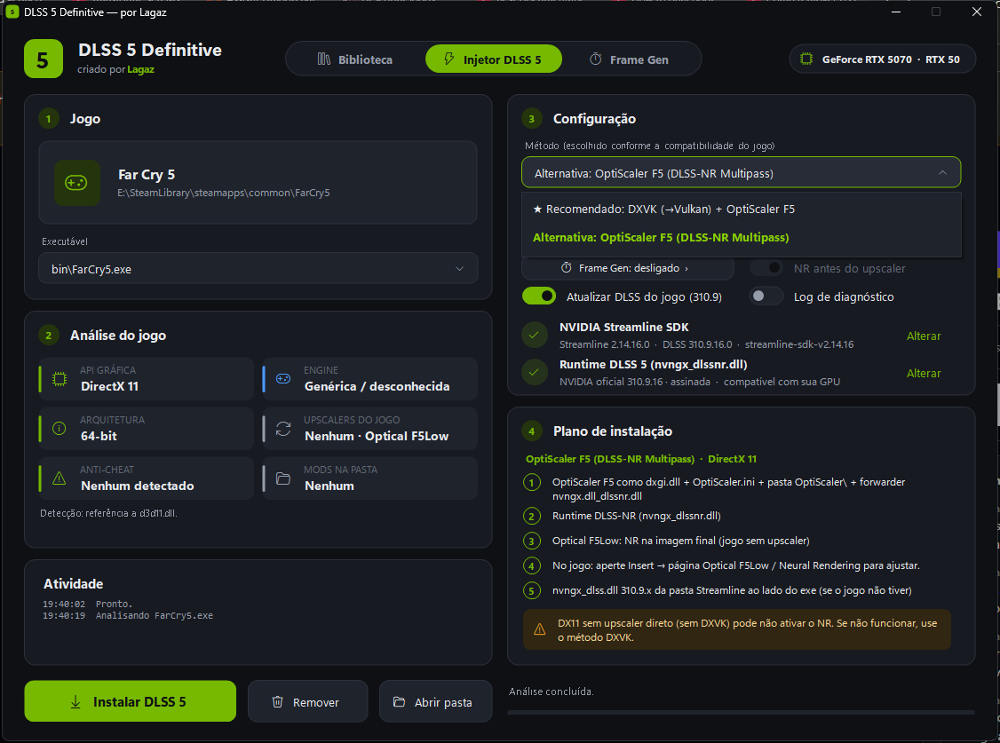
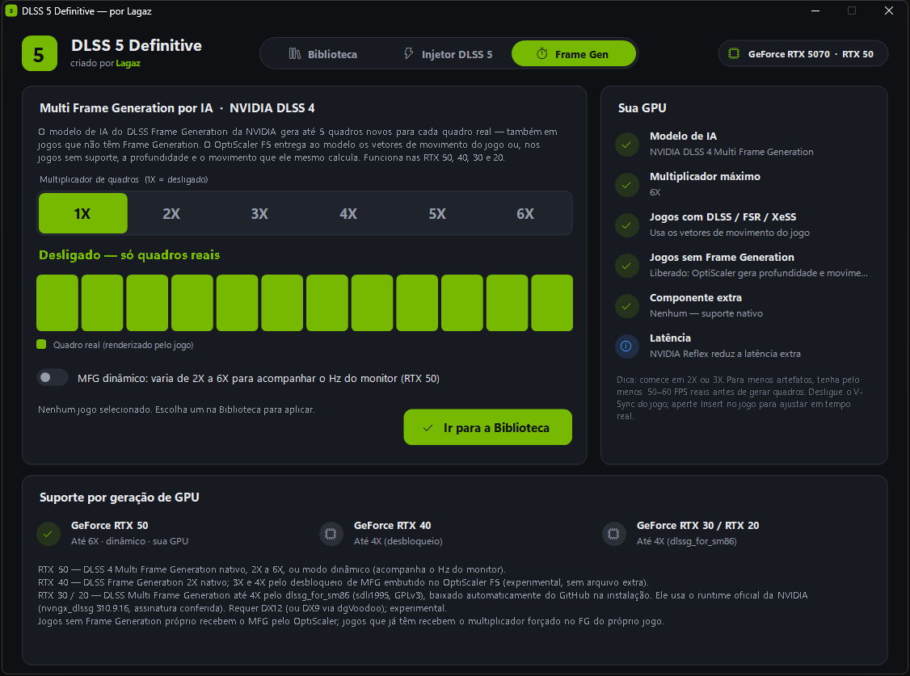

# DLSS 5 Definitive

**Criado por Lagaz** · Windows 10/11 64-bit

Aplicativo que instala o **DLSS 5 (Neural Rendering da NVIDIA)** e o **Multi Frame Generation por IA** em praticamente qualquer jogo **DirectX 12, DirectX 11, Vulkan, DirectX 10 e DirectX 9**. Ele detecta o que cada jogo precisa e escolhe sozinho o melhor caminho: [OptiScaler F5 (DLSS-NR Multipass)](https://github.com/janblade/OptiScaler-F5-DLSSNR-Multipass) ou RenoDX.



## Download

Na página de [**Releases**](../../releases/latest):

| Arquivo | Para quem |
|---|---|
| `DLSS 5 Definitive Setup.exe` | Instala o programa (sem pedir administrador), cria atalhos e aparece em *Configurações → Aplicativos*, com desinstalador. |
| `DLSS 5 Definitive Portable.zip` | Não instala nada: extraia em qualquer pasta ou pendrive. Configurações e downloads ficam na pasta `Data` ao lado do exe. |

> O Windows SmartScreen pode avisar "O Windows protegeu o computador", porque os executáveis não têm assinatura digital paga. Clique em **Mais informações → Executar assim mesmo**.

## Atualizações automáticas

O app verifica as [Releases](../../releases) deste repositório ao abrir e a cada 6 horas. Também dá para verificar na hora clicando na versão (`v2.1 · atualizações`), no cabeçalho. Quando sai uma versão nova, aparece uma faixa com o botão **Atualizar agora**. O app então:

1. baixa o arquivo certo: o Setup, se estiver instalado, ou o Portable;
2. confere o SHA-256 publicado pelo GitHub;
3. aplica a atualização e reabre sozinho, mantendo configurações e biblioteca.

Para atualizar por script: `"DLSS 5 Definitive.exe" /update-now`.

## Idiomas e configurações

O app está em **português, inglês e espanhol** e escolhe sozinho o idioma do Windows. Na aba **Configurações** (ícone de engrenagem) dá para trocar o idioma e também:

- ligar/desligar a verificação automática de atualizações;
- ver e alterar as pastas do Streamline e do runtime DLSS 5;
- abrir a pasta de dados ou limpar os downloads em cache.

## O que ele faz

### Biblioteca
- Encontra sozinho os jogos instalados: Steam, Epic, GOG, Ubisoft Connect, EA app, Xbox e pastas `Games`/`Jogos` de todos os discos.
- Mostra a **capa correta de cada jogo**: loja Steam e, para jogos fora da Steam, Wikipedia.
- **Adicionar pasta** escaneia qualquer pasta sua. Clique num jogo para configurá-lo.

### Injetor DLSS 5


- Analisa o executável: API gráfica, engine (Unreal, Unity, RE Engine…), 32/64-bit, upscalers do jogo (DLSS, FSR, XeSS), anti-cheat e mods já instalados.
- Escolhe o método conforme a compatibilidade:

| API do jogo | Método automático |
|---|---|
| DirectX 12 | OptiScaler F5 (alternativa: RenoDX, se o jogo tiver DLSS) |
| DirectX 11 com DLSS | RenoDX DLSS 5 (ReShade) — alternativa: OptiScaler `dlss_12` |
| DirectX 11 com FSR/XeSS | OptiScaler F5 (`Dx11Upscaler=dlss_12`) |
| DirectX 11 sem upscaler | DXVK + OptiScaler F5 (Optical F5Low) |
| Vulkan | OptiScaler F5 |
| DirectX 10 | DXVK + OptiScaler F5 *(experimental)* |
| DirectX 9 | dgVoodoo2 (DX9 → DX12) + OptiScaler F5 *(experimental)* |

- Baixa cada componente da versão mais recente no GitHub e **confere o SHA-256**. As DLLs da NVIDIA têm a **assinatura digital verificada**.
- Faz backup de tudo (`.dlss5bak`). O botão **Remover** devolve a pasta do jogo exatamente como era.

### Multi Frame Generation por IA


Modelo DLSS Frame Generation da NVIDIA, de **1X (desligado) a 6X**, também em jogos que **não** têm Frame Generation:

| GPU | Como |
|---|---|
| RTX 50 | DLSS 4 Multi Frame Generation nativo, até 6X, ou modo dinâmico |
| RTX 40 | 2X nativo; 3X–4X pelo desbloqueio de MFG embutido no OptiScaler F5 *(experimental)* |
| RTX 30 / 20 | Até 4X com [dlssg_for_sm86](https://github.com/sdli1995/dlssg_for_sm86), baixado automaticamente *(experimental, DX12)* |
| Outras | Intel XeSS Frame Generation / AMD FSR Frame Generation |

## Runtime do DLSS 5

O arquivo `nvngx_dlssnr.dll` (runtime do Neural Rendering) **não é distribuído** pelo app, pelo OptiScaler, pelo RenoDX nem pelo Streamline SDK. Para o app usar o arquivo, você pode:

- deixá-lo na pasta Downloads;
- selecioná-lo em **Alterar**;
- arrastá-lo para a janela do app.

O app confere a assinatura da NVIDIA e se a versão combina com a sua GPU.

A runtime e o Streamline são **copiados para a pasta do próprio app** (`components\`). O instalador faz isso na hora da instalação, e o app faz quando encontra os arquivos. Depois disso, você pode apagar os originais de Downloads. O desinstalador remove a pasta `components` junto com o app.

## Compilar

Não precisa instalar nada: o compilador C# do .NET Framework já vem no Windows.

```bat
build.bat
```

Gera `DLSS 5 Definitive.exe`, `dist\DLSS 5 Definitive Setup.exe` e `dist\DLSS 5 Definitive Portable.zip`.

| Pasta | Conteúdo |
|---|---|
| `src/` | O aplicativo (WinForms, C#) |
| `setup/` | O instalador/desinstalador |

## Aviso

Injetar DLLs em jogos com **anti-cheat** (Easy Anti-Cheat, BattlEye…) pode resultar em **banimento**. Use apenas em jogos single-player/offline. O app avisa quando detecta anti-cheat. Projeto da comunidade, sem relação com a NVIDIA.

## Créditos

Componentes baixados pelo app, cada um com sua própria licença:

- [OptiScaler F5 DLSS-NR Multipass](https://github.com/janblade/OptiScaler-F5-DLSSNR-Multipass) (janblade), baseado no [OptiScaler](https://github.com/optiscaler/OptiScaler)
- [NVIDIA Streamline SDK](https://github.com/NVIDIA-RTX/Streamline)
- [dlssg_for_sm86](https://github.com/sdli1995/dlssg_for_sm86) (sdli1995, GPLv3)
- RenoDX DLSS 5 add-on (ShortFuse e comunidade RenoDX), [ReShade](https://reshade.me) (crosire)
- [DXVK](https://github.com/doitsujin/dxvk), [dgVoodoo2](https://github.com/dege-diosg/dgVoodoo2)

## Licença

[MIT](LICENSE) © Lagaz
